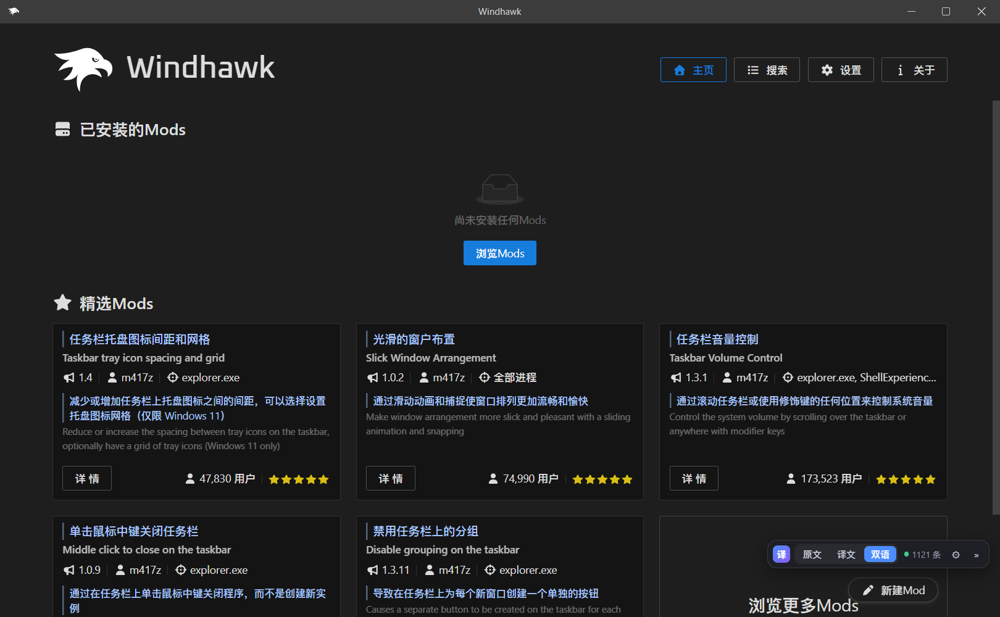
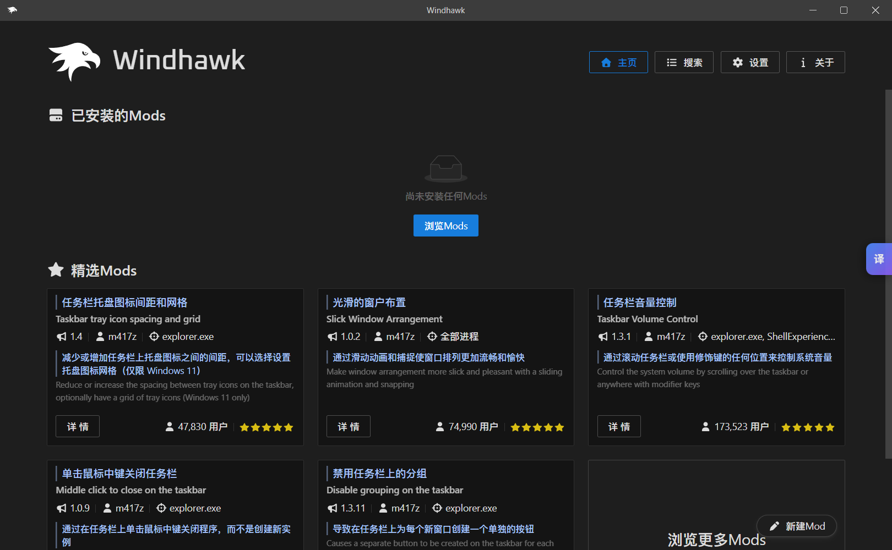
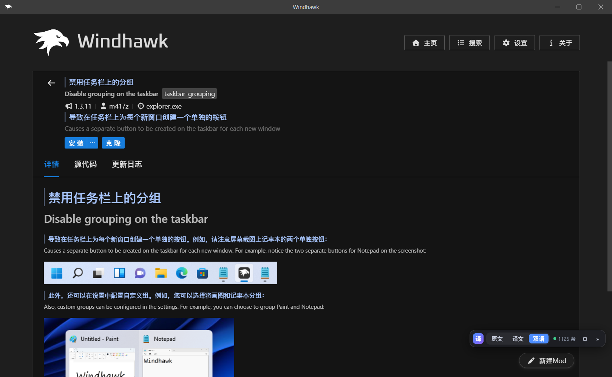
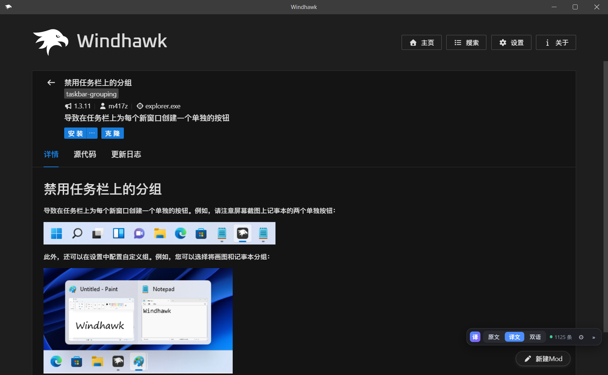
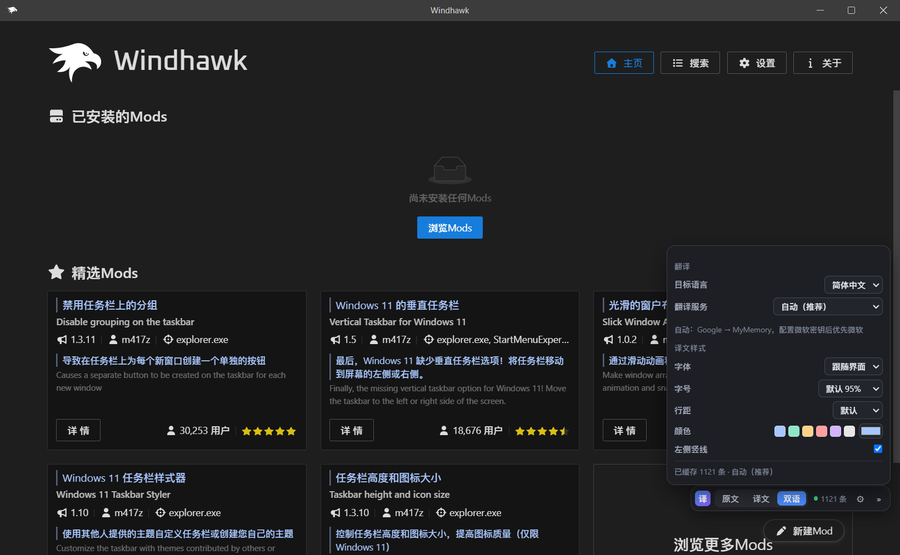

# Windhawk Translate（Windhawk 实时翻译增强）

给 [Windhawk](https://github.com/ramensoftware/windhawk) 的 **Mods 卡片**和 **Mod 详情页**加上实时翻译：
「原文 / 译文 / 双语」三种模式，双语默认 **译文在上、原文在下并缩小**，翻译结果写入本地字典固化保存，
并且 **Windhawk 自动更新后翻译功能会自动恢复**。

界面入口是一个贴在窗口右侧的「译」胶囊，平时只占一个图标的位置。



---

## 1. 功能

| 功能 | 说明 |
| --- | --- |
| 卡片翻译 | 首页「精选 Mods」、浏览页、已安装列表的 Mod 名称与描述 |
| 详情页翻译 | 标题、简介、README 正文（标题/段落/列表/引用）、更新日志 |
| 三种模式 | `原文`（关闭翻译）、`译文`（只显示中文）、`双语`（译文在上，原文在下并缩小到 85%） |
| 折叠胶囊 | 平时缩到窗口右侧只显示「译」图标，点击展开模式栏；`»` 收起，点击空白处也会收起 |
| 多种翻译服务 | 自动（Google → MyMemory → 微软）、Google、MyMemory（免密钥）；微软/必应、百度、阿里云、DeepL（需密钥） |
| 译文样式 | 字体、字号、行距、颜色、左侧竖线开关，全部实时生效 |
| 目标语言 | 简体中文 / 繁體中文 / English / 日本語 / 한국어 |
| 持久字典 | 翻译过的句子写入 `dictionary.json`，再次打开、重启、升级后直接复用，不再请求网络 |
| 译文搜索 | 在 Windhawk 的搜索框里直接输入中文，自动翻译成英文后搜索，并显示「中文 → 英文」提示与还原按钮 |
| 增量翻译 | 无限滚动、切换页面、切换 Mod 时新出现的内容自动翻译 |
| 更新自愈 | Windhawk 更新覆盖 UI 文件后，扩展会在启动时（或文件变化时）重新打补丁，必要时自动刷新一次窗口 |
| 无侵入 | 不修改 `windhawk.exe` / 引擎，不替换安装包，不接管更新流程；补丁失败时原 UI 不受影响 |

模式、语言、服务、样式、折叠状态都保存在本地（`localStorage` + 服务端 `settings.json`），下次打开保持上次的选择。

---

## 2. 安装

要求：Windhawk **1.x**（使用 VSCodium 界面的版本，本机为 1.7.3），Windows 10/11，安装目录可写（本机为 `G:\Windhawk`）。

> **安装/卸载前请先退出 Windhawk**（托盘图标 → 退出）。VSCodium 自己也会重写扩展注册表，
> 同时写入可能损坏 `extensions.json`；脚本检测到界面进程时会拒绝执行（可用 `-Force` 跳过，但不推荐）。

```powershell
# 在解压后的目录中执行（默认安装目录 G:\Windhawk）
powershell -ExecutionPolicy Bypass -File .\install.ps1

# 其它安装位置
powershell -ExecutionPolicy Bypass -File .\install.ps1 -WindhawkRoot "D:\Windhawk"
```

安装脚本会：

1. 把伴生扩展复制到 `C:\ProgramData\Windhawk\UIData\extensions\local.windhawk-translate-1.2.0\`
   并注册到同目录的 `extensions.json`（用户数据目录不参与 Windhawk 升级，扩展本身不会被覆盖）。
2. 把页面脚本 `wh-translate.js` 复制到 webview 目录，并在 `index.html` 中注入一行
   `<script src="wh-translate.js?v=<内容哈希>"></script>`。
3. 给 webview 的 CSP 追加 `https:` 与 `http://127.0.0.1:*`（翻译接口与本机字典服务需要）。
4. 备份被修改的原始文件到 `C:\ProgramData\Windhawk\Translate\backup\`。

安装完成后启动 Windhawk，窗口右侧会出现「译」胶囊。

---

## 3. 使用

### 胶囊

- 平时：只显示贴在右侧的「译」图标（默认折叠）。
- 点击「译」：展开底部模式栏 `[译] 原文 | 译文 | 双语 ● N 条 ⚙ »`。
- `»` 或点击空白处：收起回胶囊。



### 三种模式

- **原文**：隐藏所有译文，恢复原始界面。
- **译文**：隐藏原文，只显示译文（保留标题字号、段落间距、列表符号）。
- **双语**：译文在上（样式可调），原文在下并缩小到 85% 显示。





### 译文搜索

Windhawk 的搜索是**本地**按 Mod ID / 名称 / 描述做子串匹配，所以直接输入中文是搜不到的。
开启「译文搜索」（默认开启）后：

- 在搜索框输入中文，停 0.7 秒后自动翻译成英文并交给 Windhawk 过滤；
- 搜索框上方会显示 `译文搜索：任务栏 → task bar`，点「还原」可恢复中文原文，点「×」关闭提示；
- 只对含中文的输入生效，输入英文时行为不变；
- 翻译失败时会提示「翻译失败，已按原文搜索」，不会静默改词。

可以在 ⚙ 设置里关闭这个功能。

### 设置（⚙）

| 分组 | 项目 |
| --- | --- |
| 翻译 | 目标语言、翻译服务、译文搜索开关，以及所选服务的密钥/区域等配置 |
| 译文样式 | 字体（跟随界面/微软雅黑/宋体/思源黑体/等线）、字号（85%–120%）、行距（紧凑–很宽松）、颜色（6 个预设 + 取色器）、左侧竖线开关 |



### 翻译服务

| 服务 | 密钥 | 说明 |
| --- | --- | --- |
| 自动 | 不需要 | Google → MyMemory；如果配置了微软密钥会优先微软 |
| Google | 不需要 | 非官方 `translate.googleapis.com` 接口，质量好，可能限流 |
| MyMemory | 不需要 | 免费额度较小，作为兜底 |
| 微软 / 必应 | 需要 | Azure Translator（必应翻译同源）：订阅密钥 + 区域（可选，如 `eastasia`）+ 端点（默认 `api.cognitive.microsofttranslator.com`） |
| 百度翻译 | 需要 | 百度翻译开放平台 APPID + 密钥（免费版有字数限制） |
| 阿里云翻译 | 需要 | 阿里云机器翻译 AccessKey ID + Secret（`TranslateGeneral` 接口） |
| DeepL | 需要 | Auth Key，支持免费版/专业版切换 |

> 必应的免费网页接口（`ttranslatev3`）已被反爬拦截（返回空响应），Edge 的免密 token 接口也已下线，
> 因此「微软 / 必应」使用微软官方 Azure 通道，需要订阅密钥。

选择需要密钥的服务后，设置面板里会出现对应输入框，填入即生效；密钥只保存在本机 `settings.json`。
如果选中的服务没有配置好，译文区域会保持原文，状态显示「部分失败」，悬停状态栏可看到具体错误。

---

## 4. 工作原理

```
┌──────────────────────────── Windhawk (VSCodium) ────────────────────────────┐
│  webview (React)                                 扩展宿主 (Node.js)          │
│  ┌───────────────────────────────┐               ┌────────────────────────┐ │
│  │ wh-translate.js（页面脚本）    │  HTTP 127.0.0.1│ local.windhawk-translate│ │
│  │  · 扫描卡片/详情/README DOM    │ ─────────────▶│  · 字典 dictionary.json │ │
│  │  · 三模式渲染、MutationObserver│ ◀─────────────│  · 设置 settings.json   │ │
│  │  · 免密钥服务（Google 等）     │               │  · 密钥服务（微软/百度/ │ │
│  │    走页面网络（系统代理）      │               │    阿里/DeepL）签名调用 │ │
│  └───────────────────────────────┘               │  · 自愈补丁 + 窗口刷新  │ │
│                                                   └────────────────────────┘ │
└─────────────────────────────────────────────────────────────────────────────┘
```

- **页面脚本**负责 DOM 识别与渲染。它按「单元」处理：卡片标题、卡片描述、详情标题、详情简介、
  Markdown 块（`h1`–`h6`、`p`、`blockquote`、`li`）。译文节点带 `data-whtr-*` 标记，
  扫描时会被排除，避免自我循环。
- **只新增兄弟节点，绝不移动 React 的节点**：这是硬约束。React 会保留自己创建的子节点引用并调用
  `insertBefore(newNode, refNode)`；一旦把 `refNode` 移到别处（例如包进一个 wrapper），就会抛
  `Failed to execute 'insertBefore' ... is not a child of this node` 并把整个界面变成错误页。
  因此译文一律作为**源元素前面的新兄弟节点**插入；「译文」模式用属性 + CSS（`display:none`）隐藏原文，
  并把原块的计算样式（字号/字重/行高/外边距）复制到译文上，以保留标题层级与段落间距。
- **免密钥服务**（Google/MyMemory）在页面里直接请求，走 Chromium 网络栈，因此**自动使用系统代理**。
- **需要密钥的服务**（微软/必应、百度、阿里云、DeepL）由扩展宿主调用：它们没有 CORS 头，
  且密钥不应暴露在页面里；签名/鉴权在 Node 侧完成，结果同时写入字典。
- **渲染方式**：所有译文都作为源元素**前面的兄弟节点**插入（`<li>` 的译文用一个新的 `<li>` 兄弟节点，
  保留列表符号），不包裹、不移动任何 React 节点；「双语」模式下原文缩小到 85%，「译文」模式下原文隐藏、
  译文继承原块的排版。
- **样式**：通过 `--whtr-font/--whtr-size/--whtr-color/--whtr-lh` 四个 CSS 变量实时生效。

### 为什么更新后还能用

Windhawk 升级会整体替换 `G:\Windhawk\UI\...`，页面里的注入会消失；但：

1. 扩展本体位于**用户数据目录**（`UIData\extensions`），升级不会删除；
2. 扩展在**每次启动时**检查 `index.html` / `extension.js` 是否被打过补丁，缺失就重新打；
3. 扩展还用 `fs.watch` 监听 webview 与扩展目录，**升级过程中**文件一变化就立刻重新打补丁；
4. 如果补丁是在窗口已经加载之后才补上的，扩展会让窗口自动刷新一次（带 3 分钟防抖，不会循环刷新）；
5. 页面脚本的文件名带内容哈希，webview 的 Service Worker 缓存不会继续使用旧脚本。

升级模拟测试：把 `index.html`、`extension.js` 还原成原始版本并删除 `wh-translate.js`，重启后扩展日志显示
`heal(file change): wrote wh-translate.js, patched index.html, patched CSP`，界面恢复翻译（且译文直接来自字典）。

---

## 5. 字典

位置：`C:\ProgramData\Windhawk\Translate\dictionary.json`

```json
{
  "version": 1,
  "langs": {
    "zh-CN": {
      "3f1c9a2b7d4e5f60": {
        "s": "Vertical Taskbar for Windows 11",
        "t": "Windows 11 的垂直任务栏",
        "p": "google",
        "ts": 1793123963245,
        "u": 1793123963245
      }
    }
  }
}
```

- `s` 原文、`t` 译文、`p` 服务来源、`ts` 首次写入时间、`u` 最近使用时间（LRU 淘汰用）。
- 字典是普通 UTF-8 JSON，可以备份、手工修订，或作为术语表分发。
- 想固定某句译法：把对应条目的 `t` 改成想要的文案，或删除该条让它重新翻译一次。
- 设置：`C:\ProgramData\Windhawk\Translate\settings.json`（含服务密钥，注意不要外传）
- 日志：`C:\ProgramData\Windhawk\Translate\logs\extension.log`

---

## 6. 卸载

先退出 Windhawk，然后：

```powershell
powershell -ExecutionPolicy Bypass -File .\uninstall.ps1

# 同时删除字典和配置
powershell -ExecutionPolicy Bypass -File .\uninstall.ps1 -Purge
```

卸载脚本会用安装时保存的备份还原 `index.html` 与 `extension.js`，删除 `wh-translate.js`，
并从 `extensions.json` 中移除扩展条目。

---

## 7. 隐私

- 免密钥服务在页面内直接请求；密钥服务由本机扩展宿主请求。两者都只发送你看到的 Mod 文本，
  不发送账号信息、Mod 设置或本机数据。
- 服务密钥以明文保存在 `C:\ProgramData\Windhawk\Translate\settings.json`，只在本机使用，不会上传。
- 本机字典服务只监听 `127.0.0.1`，不对局域网开放。
- 为了让页面能调用翻译接口，CSP 放开了 `https:`；如果你介意，可以把 `lib/patcher.js` 与 `install.ps1`
  里的 `https:` 换成具体域名白名单。

---

## 8. 已知限制

- **仅支持 VSCodium 界面（Windhawk 1.x）**。Windhawk 2.0 换成了原生 Tauri 界面（`windhawk-ui.exe`），
  本扩展不会加载（也不会造成任何影响）。如需支持 2.0，需要按新 UI 的 WebView2 注入方式另做一套。
- 代码块（`pre`/`code`）、版本号、作者、进程名、Mod ID、表格单元格不翻译。
- README 中的内联链接在「译文」模式下会变成纯文本（「双语」模式仍保留原文链接）。
- 带子列表的 `<li>`（例如「可用图案」下面的分组）在「译文」模式下会同时保留原文，避免把子项一起隐藏。
- 含图片的块（例如主题截图 + 主题名）在「译文」模式下不隐藏原文，译文显示在图片上方，图片和图注保持可见。
- 每个译文单元只翻译一次，之后都读字典；修改目标语言会重新走一遍（另一语言的字典分开存储）。

---

## 更新日志

### v1.2.0（2026-10-31）

- **新增「译文搜索」**：搜索框输入中文（如「任务栏」「开始菜单」「音量」）时自动翻译成英文再搜索，
  并在搜索框上方显示「中文 → 英文」提示与还原按钮；可在设置里关闭。
- 搜索提示条会自动避开结果列表（显示在搜索框上方、右对齐）。

### v1.1.2（2026-10-31）

- **修复**：「译文」模式下 Mod 详情里的图片消失。原因是图片与说明文字在同一个 `<p>` 里
  （`<p><a><br>主题名</a></p>`），隐藏整个块把图片一起隐藏了。现在含图片的块永不隐藏，
  译文显示在图片上方，图片与图注保留；纯文本块仍按原逻辑隐藏原文。

### v1.1.1（2026-10-31）

- **修复**：安装 Mod 后界面出现 `Unexpected Application Error! Failed to execute 'insertBefore' ... is not a child of this node`。
  原因是旧实现把 `<p>`/`<li>` 的子节点包进 `.whtr-src` wrapper，React 随后仍拿被移动的节点当 `insertBefore` 参考。
  现在译文一律作为兄弟节点插入，不再包裹/移动任何 React 节点；「译文」模式改为属性隐藏 + 排版样式复制。

### v1.1.0（2026-10-28）

- 多翻译服务（微软/必应、百度、阿里云、DeepL + Google/MyMemory）
- 译文样式设置（字体/字号/行距/颜色/竖线）
- 双语改为「译文在上、原文在下并缩小」
- 右侧折叠「译」胶囊

---

## 9. 故障排查

| 现象 | 处理 |
| --- | --- |
| 右侧没有「译」胶囊 | 看 `logs\extension.log` 是否有 `activate:`；确认 `extensions.json` 中 `local.windhawk-translate` 条目有效；重启 Windhawk |
| 显示「部分失败」 | 鼠标悬停底部状态栏看错误；检查所选服务的密钥/区域；或切回「自动」 |
| 工具栏在，但一直显示「N 条」不翻译 | 设置里换翻译服务；检查系统代理是否能访问翻译接口 |
| 更新后界面恢复英文 | 看日志有没有 `heal(...)`；确认扩展目录仍在 `UIData\extensions` 下 |
| 安装报「安装已中止：请先关闭 Windhawk」 | 托盘图标 → 退出，再安装 |
| 端口冲突 | 服务会在 19733–19760 间自动找空闲端口，页面也会逐端口探测 |

---

## 10. 文件清单

```
windhawk-translate/
├─ install.ps1                     安装：部署扩展、注册、打补丁（会检查 Windhawk 是否在运行）
├─ uninstall.ps1                   卸载：还原、清理
├─ README.md
├─ docs/                           截图
└─ extension/
   ├─ package.json                 扩展清单（local.windhawk-translate）
   ├─ extension.js                 激活、补丁、自愈、窗口刷新、命令
   ├─ lib/patcher.js               index.html / CSP 补丁（幂等，带内容哈希）
   ├─ lib/server.js                127.0.0.1 字典/设置/翻译 API
   ├─ lib/providers.js             微软/必应、百度、阿里云、DeepL、Google、MyMemory 适配
   ├─ lib/store.js                 原子写、LRU 字典、设置（含样式/密钥）
   └─ assets/wh-translate.js       页面脚本（DOM 扫描、三模式、样式、胶囊、翻译调度）
```

安装后运行时位置：

- 扩展：`C:\ProgramData\Windhawk\UIData\extensions\local.windhawk-translate-1.2.0\`
- 数据：`C:\ProgramData\Windhawk\Translate\`
- 注入：`G:\Windhawk\UI\resources\app\extensions\windhawk\webview\wh-translate.js`（+ `index.html` 一行 script）
- CSP：`G:\Windhawk\UI\resources\app\extensions\windhawk\dist\extension.js` 中 `connect-src` 追加白名单

---

## 11. 本机验证记录

- Windhawk 1.7.3（VSCodium 1.74.2），Windows 11 28000。
- 卡片：首页/浏览页/已安装列表，三种模式均正确；无限滚动 30 → 60 → 90 张卡片持续增量翻译。
- 双语：译文在上、原文缩小到 85%；详情标题/简介/README（标题/段落/列表/引用）与更新日志均生效。
- 样式：字体（宋体）、字号（120%）、行距（1.85）、颜色（取色器）实时生效，重启后保持。
- 胶囊：默认折叠，仅显示右侧「译」图标；点击展开模式栏，`»` 收起。
- 服务：Google/MyMemory 免密钥可用；微软/百度/阿里/DeepL 适配器已接入，未配置密钥时返回明确错误（不会静默换源）。
- 服务端链路：`/translate` 经扩展宿主调用 MyMemory 返回译文并写入字典，验证通过。
- 字典：`dictionary.json` 持久化，重启后直接命中（无网络请求）。
- 更新自愈：还原原始文件并删除注入脚本后重启，扩展自动重新打补丁、刷新窗口，翻译恢复。
- v1.1.1 回归：走查 首页 → 浏览（滚动加载 30/60/90 张卡片）→ 详情 → 更新日志 → 源代码（Monaco）→ 返回 →
  安装 Mod → 设置页 → 三种模式切换，全程无 `Unexpected Application Error`、无 console 异常；
  安装 Mod 的完整流程（新增卡片、列表刷新）也不再触发 `insertBefore` 崩溃。
- v1.1.2 回归：`Windows 11 Taskbar Styler` 详情页 43 张图片，译文态 43/43 可见。
- v1.2.0 回归：搜索「任务栏」→ `task bar`（任务栏相关 Mod）、「开始菜单」→ `start menu`、
  「时钟」→ `clock`、「音量」→ `volume` 均返回正确结果；「还原」恢复中文、清空搜索框后提示自动消失。
